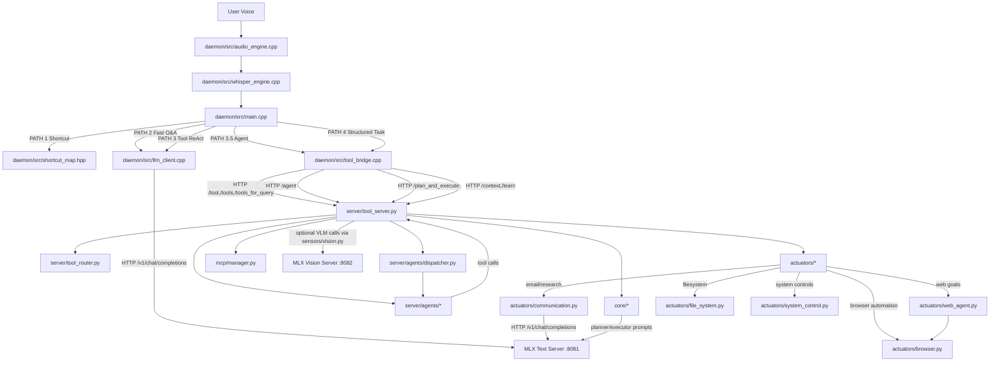

# DEMASCAS Architecture Graph

This graph shows how audio, daemon routing, tools, agents, and model servers are connected.

## Key Runtime Dependencies

- Text LLM endpoint: http://127.0.0.1:8081/v1/chat/completions
- Tool server endpoint: http://127.0.0.1:5001
- Agent orchestration: server/agents/* via /agent
- Structured task engine: core/task_executor.py via /plan_and_execute
